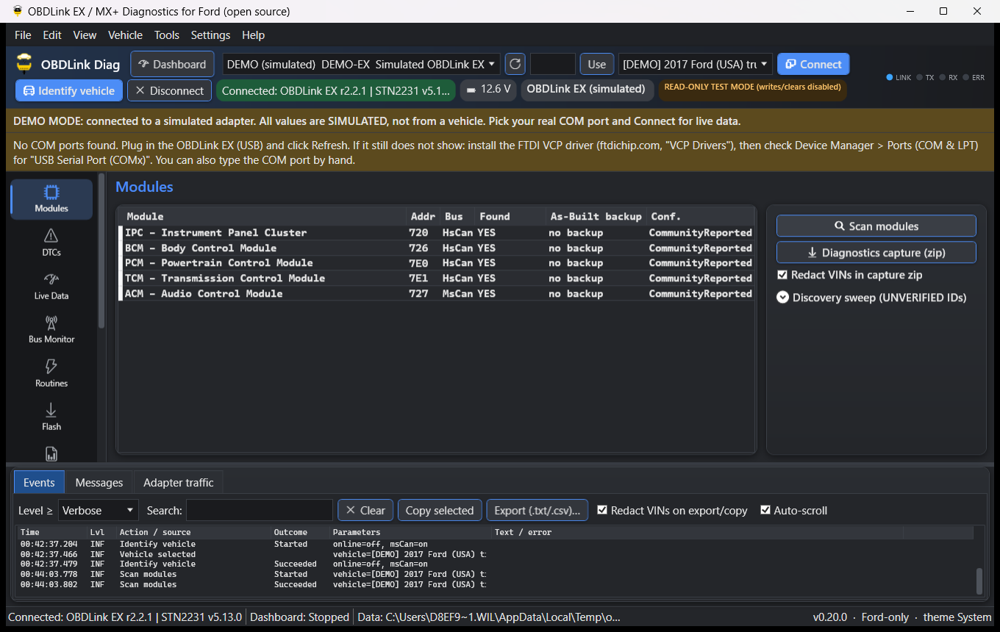
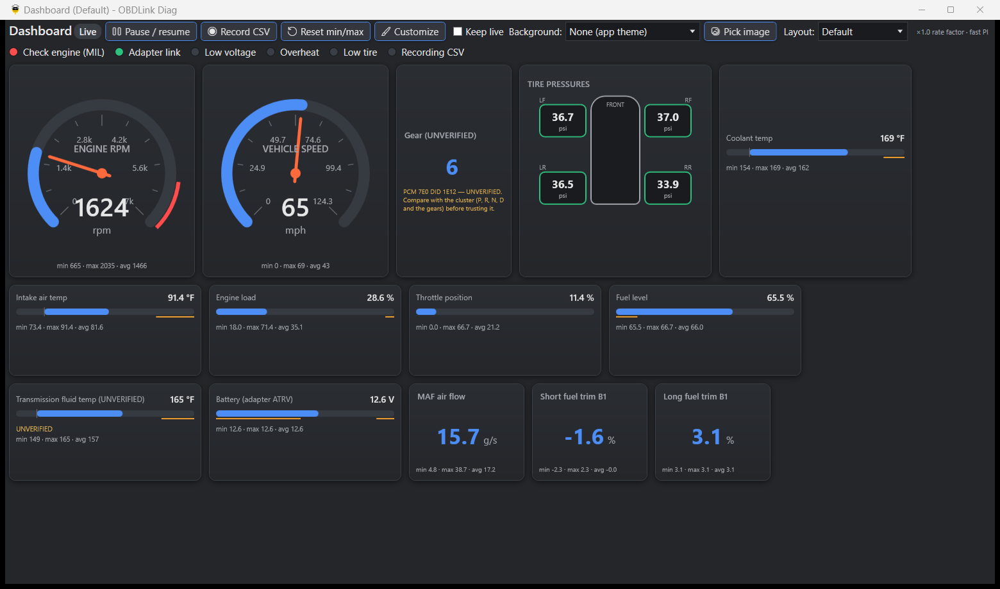
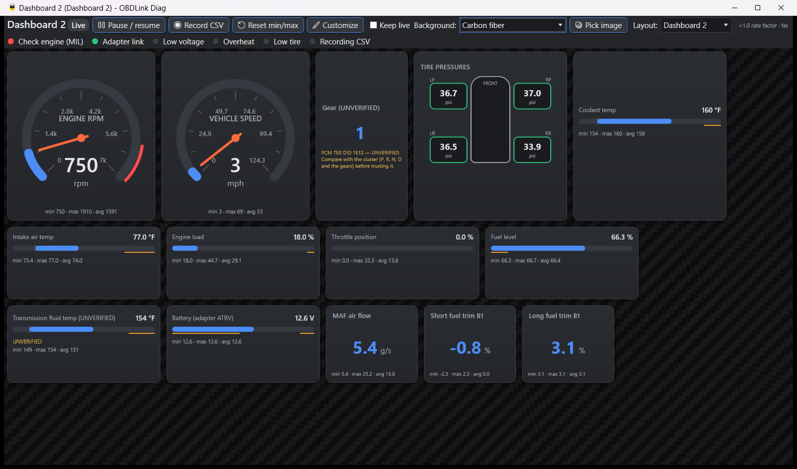
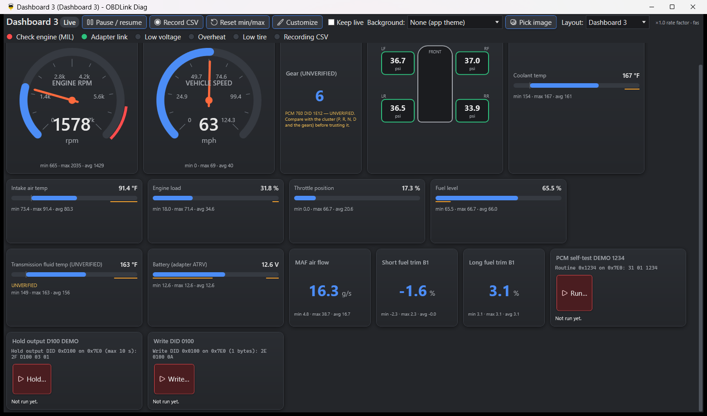
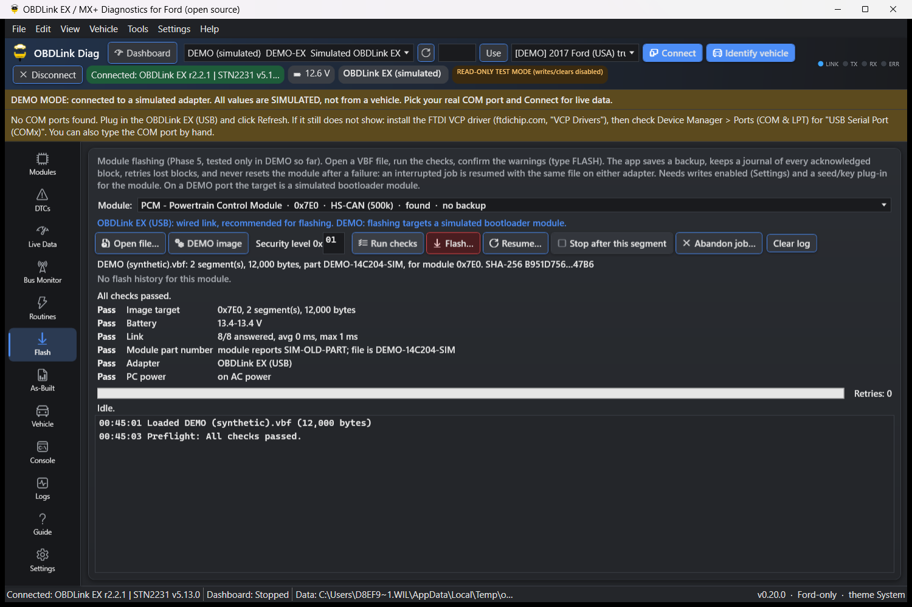
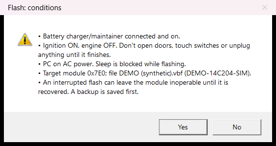
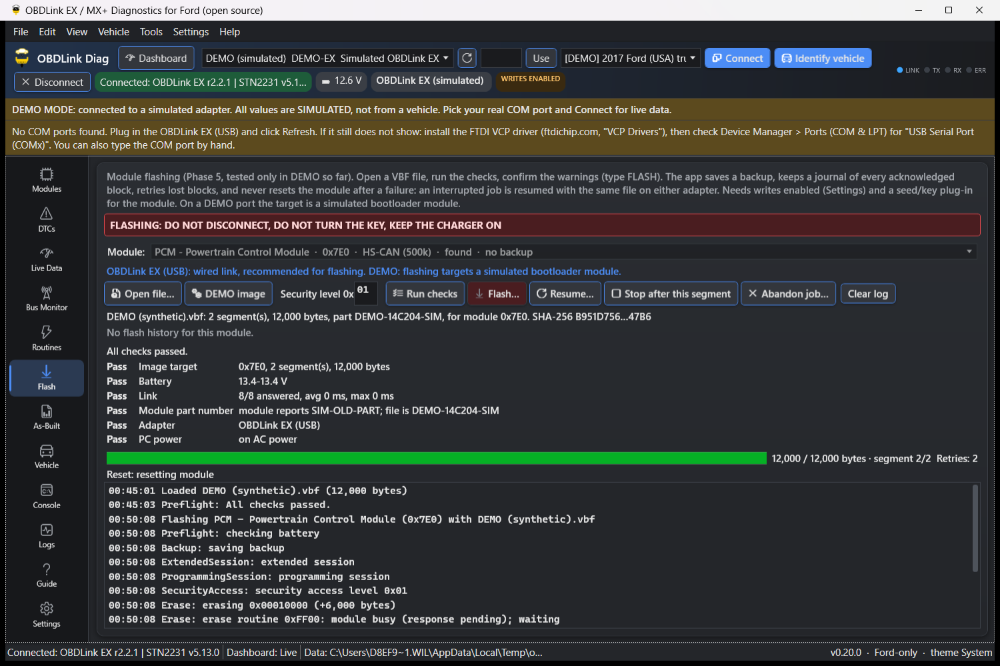
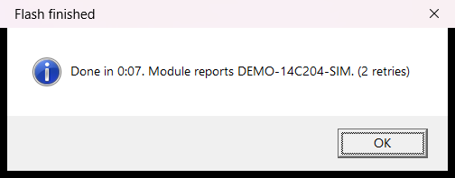

# OBDLink EX / MX+ Diagnostics for Ford (open source, MIT)

A Windows diagnostic app for the **OBDLink EX** (USB) and **OBDLink MX+** (Bluetooth) STN-based adapters. The app is **Ford-only**; the priority vehicle is the **2017 Ford F-150** (HS-CAN + MS-CAN, As-Built). It detects which adapter is connected and adjusts timeouts, buses and warnings to it. See `PLAN.md` for the design.

> ⚠ Writing module configuration or flashing a module can make a vehicle inoperable. Back up first, keep a battery maintainer connected, and use this at your own risk.

## Screenshots

Real captures of v0.20.0 on Windows 11 (DLN-DALEW2), connected to the built-in **DEMO-EX** simulator: every value below is simulated, not from a vehicle.

**Main window: module scan.** The header shows the detected adapter (*OBDLink EX (simulated)*), battery voltage and the write state (*READ-ONLY TEST MODE* by default at every start). The left rail holds the pages: Modules, DTCs, Live Data, Bus Monitor, Routines, Flash, As-Built, Vehicle, Console, Logs, Guide, Settings.



### Three dashboard pop-out windows (v0.20.0)

View → **Dashboard** (Ctrl+Shift+G), **Dashboard 2** (Ctrl+Shift+2) and **Dashboard 3** (Ctrl+Shift+3). Each window keeps its own layout, background and position; one shared poll loop feeds all of them and reads only what the open windows show. Gauges: analog/digital dials, bars, tiles, lamps, a tire-pressure top view, and the gear tile (marked UNVERIFIED until checked against the cluster).



*Dashboard 2 with its own layout and the carbon-fiber background:*



*Dashboard 3 with **write cards** (bottom row): a routine start (31 01, type RUN), an output hold (2F 03, type HOLD, released after 10 s or when the window closes) and a DID write (2E, type WRITE, with the old value read first and a read-back after). Each card shows the exact request it sends. Nothing is sent until writes are enabled, the battery check passes and the phrase is typed. Airbag deployment routines, flashing routines, As-Built blocks and identification DIDs are refused on every path. Layouts, write cards included, export to and import from `.dashboard.json` files.*



### Module flashing (v0.19.0, tested on a simulated module only)

**Flash** tab: open a VBF file (or the synthetic DEMO image), run the checks: file vs module, battery window, link health, part number, adapter, PC power. On an OBDLink MX+ the adapter line is a warning (wireless link; wired EX recommended), not a block.



*The warnings you confirm, then type FLASH:*



*Flashing: red do-not-disconnect banner, progress, retries absorbed (lost answers are resent with the same block counter), and a journal of every acknowledged block so an interrupted job can be resumed on either adapter. The module is never reset after a failure.*





Engine, error handling and what is still UNVERIFIED for real Ford modules: `docs/FLASHING.md`. Check a real VBF offline first with `obdcli vbf-info --file x.vbf`.

## What works today (v0.21.0, 2026-11-16)

How far each area has been checked. **CI** = built and unit-tested by GitHub Actions on Windows and Linux (simulators only). **DEMO run** = run by hand on Windows against the built-in simulator. **Truck** = checked on Dale's 2017 F-150.

| Area | Since | Reads | Writes | Checked |
|---|---|---|---|---|
| Connect, EX / MX+ detection, DEMO simulators | v0.3.x | ✓ | — | Windows (v0.3.x, Dale), DEMO run (v0.20.0), CI |
| Module scan, vehicle ID grid, Mode 6 | v0.9.0 | ✓ | — | DEMO run (v0.20.0 screenshots), CI |
| DTCs: all modules, details, freeze frame, clear | v0.8.0 | ✓ | clear (gated) | CI |
| Live data browser, charts, replay, triggers | v0.10.0 / v0.12.0 | ✓ | — | CI |
| Dashboards: three pop-out windows, layouts, export/import | v0.20.0 | ✓ | layouts only | DEMO run (screenshots), CI; tire-pressure DIDs 2813-2816 verified on the truck |
| Dashboard write cards: routine 31, output hold 2F, DID write 2E | v0.20.0 | — | gated, typed phrase | Added on DEMO, not pressed; CI |
| Bus monitor (HS / MS / HS2) | v0.13.0 | ✓ | — | CI |
| Routines tab (31) | v0.11.0 | — | gated | CI |
| As-Built: read, backup, compare, options by name, write + verify, history, undo, write journal + unfinished-write recovery | v0.6.1–v0.21.0 | ✓ | gated, backup first | Windows (v0.3.x, Dale); writes CI only |
| Module flashing (Flash tab, journaled engine, resume) | v0.19.0 | — | gated, typed FLASH | DEMO flash end to end (simulated module); never on a real module |
| `obdcli` (read-only), J2534 devices, `vbf-info` | v0.17.0–v0.19.0 | ✓ | — | CI |
| Seed/key plug-ins (user-supplied, none shipped) | v0.7.0 | — | — | CI |

Not built, by decision: airbag/pretensioner deployment routines (E200-E2FF) and immobilizer/anti-theft bypass.

## Documentation

| Doc | What it covers |
|---|---|
| `docs/GUIDE.md` | How to use the app (also the in-app Guide tab) |
| `docs/RELEASE-NOTES.md` | Every version, with its Windows + truck check list |
| `docs/ROADMAP-FORSCAN-PARITY.md` | Feature comparison with FORScan / UCDS and the phased plan |
| `docs/ENHANCED-UDS.md` | Every UDS service, DID and routine the app sends, generated from the code |
| `docs/UDS-0x27-SECURITY-ACCESS.md` | SecurityAccess (0x27) reference: parameters, sub-functions, NRCs, timing, display design |
| `docs/FLASHING.md` | Flash engine, error handling, what is UNVERIFIED for real Ford modules |
| `docs/ADAPTERS.md` | OBDLink EX / MX+ detection, buses, timeouts, other adapters |
| `docs/CLI.md` | `obdcli` reference |
| `PLAN.md` | Original design plan (v0.1, historical) |

## Status (v0.21.0 on master, 2026-11-16)
- **On master:** v0.6.1 write-safety fixes, v0.7.0 seed/key plug-ins (none shipped), v0.8.0 DTC detail, v0.9.0 Mode 6 and module IDs, v0.10.0 live-data browser (read-only, services 01/22), v0.11.0 Routines tab (UDS 31 start/stop/results behind write mode, session keep-alive; airbag deployment and flashing routines always refused), v0.12.0 live-data charts, CSV replay and threshold triggers, v0.13.0 read-only bus monitor (HS/MS/HS2, per-ID rates and changed bits, CSV), v0.14.0 multi-PID OBD-II polling (up to 6 PIDs per request), v0.15.0 As-Built options by name (community sheet → grid → normal safe write), v0.16.0 As-Built change history and undo, v0.17.0 `obdcli` command line (read-only, `docs/CLI.md`), v0.18.0 J2534 pass-thru devices in `obdcli` (VCM II / Mongoose / clones; x86 build for 32-bit drivers), v0.19.0 Flash tab and journaled flash engine (EX and MX+, tested on a simulated module only; `docs/FLASHING.md`), v0.20.0 three dashboard pop-out windows with per-window layouts, layout export/import and gated write cards, v0.20.1 dashboard and dialog fixes found while taking the screenshots, v0.21.0 As-Built write journal and recovery of writes that did not finish (pulled adapter, crash, read-back mismatch). Bus routing moved into Core (`ObdLink.Core.Modules.BusRouter`), the first step of splitting `MainViewModel`. Details: `docs/RELEASE-NOTES.md`.
- **Not yet verified on the truck** since v0.6.0: every version from v0.6.1 on is built and unit-tested on Windows and Linux by CI only. Run each version's "Windows + truck verify" list before tagging a release.
- **Latest tagged release:** v0.6.0.
- **Ford data parameters:** `docs/ford-data-parameters/` lists 1,451 Ford live-data parameter names (PCM, TCM, ABS, GEM, 4x4, PATS, TPM, Airbag) with value ranges and descriptions, plus sensor reference tables. Reference only: no DIDs or scaling, so the app does not read them by name.
- **UDS reference:** `docs/ENHANCED-UDS.md`: Ford module addresses, the services the tool sends (and which are gated), identification and As-Built DIDs, built-in enhanced PIDs, routine ranges, refusals and NRCs. Generated from the code and checked by a test, so it matches what the app does.
- **Next:** run the v0.19.0 / v0.20.x Windows checks (DEMO first), MainViewModel split, J2534 in the app. Plan and gaps: `docs/ROADMAP-FORSCAN-PARITY.md`.

## Layout
```
ObdLink.sln
src/ObdLink.Core          transport, ELM/STN, ISO-TP, UDS, OBD-II (incl. Mode 6), modules + bus routing, As-Built, DTCs, live data, safety, seed/key plug-in loader, logging
src/ObdLink.App           WPF UI (net8.0-windows): connect (EX / MX+ detection), vehicle + module IDs, modules, DTCs, As-Built grid, live data, bus monitor, routines, flash, three dashboard windows, console, settings, log
tests/ObdLink.Core.Tests  xUnit tests against SimulatedAdapter (no hardware needed)
tools/AbTool              command-line .ab/.abt helper
tools/SeedKeyPluginSample template for a user-supplied seed/key plug-in (answers the DEMO simulator only)
tools/GenerateBackgrounds  generator for the dashboard background images
tools/*.py                importers for the module acronym list and community As-Built sheet
community-db/             community As-Built feature data (JSON + schema)
docs/                     release notes, roadmap, audits
```

## Build
```
dotnet build ObdLink.sln          # .NET 8 SDK. Windows: everything. Linux: Core + tests + App (EnableWindowsTargeting) compile
dotnet test tests/ObdLink.Core.Tests
```
On Windows, choose **DEMO (simulated)** in the Port box to try the UI without an adapter.

Every push and pull request is built and tested on Windows and Linux by GitHub Actions (`.github/workflows/ci.yml`). The Windows job also uploads an unsigned `win-x64` build as an artifact for hands-on testing.

Roadmap toward FORScan-level features: `docs/ROADMAP-FORSCAN-PARITY.md`.

## Supported Windows / portable

**Supported Windows:** Windows 10 version 1607 (Anniversary Update) or later, or Windows 11; **x64: download `ObdLinkApp-win-x64-v<version>.zip` (almost all PCs).** Older test builds used the name `ObdLinkApp-test-win-x64-v<version>.zip`. `ObdLinkApp-ARM64-only-v<version>.zip` is for Snapdragon/ARM Windows PCs only; most PCs need the x64 download (check Settings → System → About → System type). Windows 7, 8 and 8.1 are **not supported** (.NET 8 does not run there, so the exe will not start). **Portable, no installer:** unzip the folder and run OBDLinkDiag.exe; settings and data stay in the `Data` folder next to the exe. There is no installer and none is planned.

## Tested platforms
| Platform | Build | Mode | Result |
|---|---|---|---|
| Windows 11 Pro 24H2 (x64) | v0.1.3-test, v0.1.4-test | Simulator / demo (DEMO-MX+, DEMO-EX) | Run and tested by Dale |
| Windows 11 Pro 24H2 (x64) | v0.2.0-test, v0.2.1-test, v0.2.2-test | Simulator / demo | Run and tested by Dale |
| Windows | v0.3.0 through v0.3.5 | Windows-tested by Dale | **Windows-tested** (Dale confirmed) |
| Windows | v0.4.0 | - | New build; verify on Windows (see release notes) |
| Windows | v0.5.0 | - | New build; verify on Windows (see release notes) |
| Windows | v0.5.1 | - | New build; verify on Windows (dashboard drag-to-reorder; see release notes) |
| Windows | v0.5.2 | - | New build; verify on Windows (analog and digital cabin backgrounds; see release notes) |
| Windows | v0.6.0 | - | New build; verify on Windows (dashboard pop-out, Keep live, material backgrounds; see v0.6.0 release notes) |
| Windows | v0.6.1 | CI (windows-latest) build + unit tests | Write-safety fixes; verify on Windows and on the truck (see v0.6.1 release notes) |
| Windows | v0.7.0 | CI (windows-latest) build + unit tests | Seed/key plug-ins; verify on Windows (see v0.7.0 release notes) |
| Windows | v0.8.0 | CI (windows-latest) build + unit tests | DTC detail (Phase 1); verify on Windows and the truck (see v0.8.0 release notes) |
| Windows | v0.9.0 | CI (windows-latest) build + unit tests | Mode 6, module ID grid (Phase 1); verify on Windows and the truck (see v0.9.0 release notes) |
| Windows | v0.10.0 | CI (windows-latest) build + unit tests | Live-data browser (Phase 2); verify on Windows and the truck (see v0.10.0 release notes) |
| Windows | v0.11.0 | CI (windows-latest) build + unit tests | Routines tab + session keep-alive; verify on Windows and the truck (see v0.11.0 release notes) |
| Windows | v0.12.0 | CI (windows-latest) build + unit tests | Live-data charts, replay, triggers; verify on Windows and the truck (see v0.12.0 release notes) |
| Windows | v0.13.0 | CI (windows-latest) build + unit tests | Bus monitor; verify on Windows and the truck (see v0.13.0 release notes) |
| Windows | v0.14.0 | CI (windows-latest) build + unit tests | Multi-PID polling; verify on Windows and the truck (see v0.14.0 release notes) |
| Windows | v0.15.0 | CI (windows-latest) build + unit tests | As-Built options by name; verify on Windows and the truck (see v0.15.0 release notes) |
| Windows | v0.16.0 | CI (windows-latest) build + unit tests | As-Built change history + undo; verify on Windows (see v0.16.0 release notes) |
| Windows | v0.17.0 | CI (windows-latest) build + unit tests | obdcli command line; verify on Windows and the truck (see v0.17.0 release notes) |
| Windows | v0.18.0 | CI (windows-latest) build + unit tests | J2534 devices in obdcli; verify with a J2534 device (see v0.18.0 release notes) |
| Windows | v0.19.0 | CI (windows-latest) build + unit tests | Flash tab; DEMO flash + truck preflight only (see v0.19.0 release notes) |
| Windows 11 (DLN-DALEW2) | v0.20.0 | DEMO-EX, driven by automation for the README screenshots | Module scan, three dashboard windows, write cards added (not pressed), DEMO flash end to end. Not a full v0.20.0 verify pass |
| Windows | v0.21.0 | CI (windows-latest) build + unit tests | As-Built write journal, "write did not finish" banner with Check / Restore backup (see v0.21.0 release notes) |
| Real vehicle (2017 F-150, OBDLink MX+/EX) | TPMS DIDs 2813-2816 | Read | Verified by Dale. OSS DID 1E13 is still UNVERIFIED |

Release builds are **unsigned** (SmartScreen "More info -> Run anyway"). v0.2.0-v0.2.2 were tested on Windows 11 Pro 24H2 (demo mode) by Dale. v0.3.0-v0.3.5 are Windows-tested (Dale confirmed). v0.4.0, v0.5.0, v0.5.1, v0.5.2, and v0.6.0 are compiled on Linux and still need the Windows checks in the release notes. The v0.6.0 checks are in `docs/RELEASE-NOTES.md` under **v0.6.0**.

## Verified facts and sources
| Item | Value | Source |
|---|---|---|
| STN HS-CAN ISO 15765 11-bit 500k | `STP 33` (29-bit: 34) | OBDLink Family Reference & Programming Manual (FRPM), "OBD Protocol ST Commands"; OBDLink MX Protocol Commands sheet (scantool.net/downloads/118) |
| STN MS-CAN ISO 15765 11-bit 125k, pins 3/11 | `STP 53` (29-bit: 54) | same |
| J1850 PWM / VPW | `STP 11` / `STP 12` | same |
| As-Built line checksum | low byte of the sum of (module hi, module lo, block, line, data bytes) | FORScan forum t=2012; f150forum FORScan thread p.13 worked examples (used as test vectors) |
| DTC 2-byte encoding | SAE J2012 / J1979 | public J1979 documentation |

**Brief discrepancy:** the task brief said "STP 53 (HS-CAN) / STP 54 (MS-CAN)". That's wrong according to the FRPM: 53 and 54 are both MS-CAN (11-bit and 29-bit). HS-CAN is 33. The presets can be changed in `BusProfile`.

## Unverified / stubbed (see code comments marked [UNVERIFIED]/[STUB]/[TODO])
- As-Built block → UDS DID mapping `0xDE00 + (block-1)` and 5 data bytes per line come from community convention. Confirm both with a capture before writing.
- F-150 2017 module addresses and bus assignments come from community reports (each row has a `Confidence`). The scanner probes both buses.
- Multi-frame transmit uses host-side ISO-TP with `ATCAF0`. It hasn't been timed on real MX+ hardware over Bluetooth.
- UDS 0x78 (response pending): over the ELM/STN interface the client re-requests only for idempotent services (a transport that can keep receiving waits up to P2* instead, per ISO 14229-2). Since v0.6.1 a write that gets 0x78, no reply, or a link drop is settled by reading the block back, and the result says so.
- 0x27 SecurityAccess: no proprietary algorithms are included. Since v0.7.0 you can add your own seed/key plug-in (Settings → Security access; template in `tools/SeedKeyPluginSample`). Off by default; only plug-ins you approve by SHA-256 load.
- The DTC DB is a small stub of SAE generic titles.
- The battery threshold of 12.5 V is a project default, not an OEM specification.

## History: v0.1.1 additions
- **Logging.** The bottom panel has Events, Messages, and Adapter traffic tabs, each with filter, search, copy, and export (.txt/.csv; VINs redacted by default). Rolling files go to `Data\logs` next to the exe (portable; falls back to `%LOCALAPPDATA%\OBDLinkDiag` if the app folder is read-only) (`events-`, `app-`, and `traffic-YYYYMMDD.log`) and are included in the Diagnostics capture zip.
- **Module names.** Full names come from `community-db/ford-module-acronyms` (74 entries) and appear in the grid, the As-Built view, DTCs, and logs. Names only; CAN addresses are not changed.
- **Community data.**
  - `f150-asbuilt` (2015-20, Livnitup sheet).
  - `f150-2021plus-asbuilt` (2021+, **not for 2017**).
  - `livnitup-forscan-tutorial`.
  - Read-only reference; there is no in-app feature browser yet.
- **Guide.** docs/GUIDE.md and the in-app Guide tab (credit: Livnitup).
- **Themes.** Light, Dark, or Follow Windows. They switch live and the choice is saved in settings.
