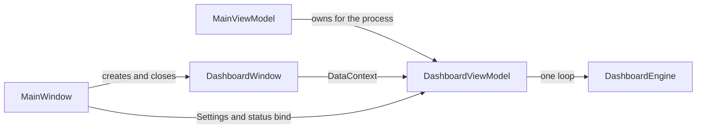

# Dashboard pop-out — v0.6.0 design

**Status:** Approved. This document is the implementation spec for version 0.6.0.
**Product:** OBDLink Diag, the MIT-licensed portable Windows OBD app (C# / .NET 8 WPF) in Open-Source-OBDII-Scan-Tool. Dale Wilcox owns the project.
**Baseline:** v0.5.2 (`ObdLink.App` `<Version>0.5.2</Version>`). This spec does not change that version. The implementation that follows this spec sets the version to 0.6.0.

Standing product rules that this revision keeps: no installer; every write stays under the app `Data\` folder; American spelling (tire, aluminum, canceled); portable publish is win-x64 and ARM64 only.

## Goals

1. The dashboard leaves the left navigation and opens in its own resizable window, so Modules, DTCs, As-Built, and the other pages stay usable while gauges are on screen.
2. Live polling stops when that window closes, unless the user turns on **Keep live**.
3. The v0.5.2 late-model Ford cabin photographs are removed and replaced with six non-tiled material photographs.
4. Each needle-capable gauge can be Analog or Digital on its own, and the choice is saved with the layout.
5. Customize, saved layouts, arrange-width memory, and auto-stack keep their current behavior inside the pop-out window.

## Non-goals

- New sensor or gauge data sources. v0.6.0 only changes how existing widgets are presented.
- An undockable docking framework, per-gauge windows, or dragging gauges out of the dashboard window.
- A theme overhaul. Light, Dark, and System stay as they are. Background images are the only visual theme change.
- An installer, a version bump inside the pull request that adds this spec, or any publish RID besides win-x64 and win-arm64.
- Changing read-only startup, Ford PID verification, TPMS DIDs, or the poll set for a layout.

## Current behavior the design builds on

v0.5.2 hosts the dashboard as the first left-nav page (`TabItem` header `Dashboard`). `MainViewModel.SelectedTab` defaults to `"Dashboard"`. `Shortcuts.Pages` is Dashboard, Modules, DTCs, As-Built, Vehicle, Console, Logs, Guide, Settings, and Alt+1 opens Dashboard.

`MainViewModel` owns one `DashboardViewModel` for the process. `Update(pageVisible, connected)` starts a single poll loop when the Dashboard tab is selected and the adapter is connected, and cancels it otherwise. `RunAfterAsync` waits for the previous loop so a quick hide/show cannot start a second loop (the v0.3.4 guard). Inside the loop, the user **Pause** flag (`Ctrl+P`) skips polls and leaves the loop running. Status text is `Stopped` when the loop is inactive, `Paused` when the user pause flag is set, and `Live` while polling. CSV recording writes a row only after a completed poll.

Layouts, display kind (`Dial`, `Bar`, `Tile`, `Lamp`, `Tpms`), item size, and `ArrangeWidth` are stored in `Data\settings.json` under `Dashboard`. `DashboardFlow` pins the wrap to the width last used in Customize when the viewport is at least that wide, and stacks gauge-height cards only when the viewport is narrower than the widest saved card. The viewport today is the dashboard tab's `ScrollViewer`, so the main window width drives the flow.

Built-in backgrounds are ids `None`, `Analog`, `Wood`, `Steel`, `Mirror`, `Onyx`, `Leather`, `Carbon`, `Brushed`, and `Custom`. In v0.5.2 those ids (except `None` and `Custom`) select late-model cabin JPEGs in `assets/backgrounds/`, drawn with `Stretch.UniformToFill` and `TileMode.None` plus a black scrim of alpha `0x48`. A custom image is copied into `Data\backgrounds` (PNG, JPEG, BMP, or GIF, 15 MB maximum) and is never stored as an absolute path.

## UX

### Shell and navigation

Remove the Dashboard entry from the left nav. Delete that `TabItem`. Do not leave an empty selectable header.

The main window's default page is **Modules**, which is the next page after Dashboard in the current rail. `SelectedTab` defaults to `"Modules"`. Any code path that still assigns `"Dashboard"` as a page name selects Modules instead.

After the removal, `Shortcuts.Pages` is:

1. Modules
2. DTCs
3. As-Built
4. Vehicle
5. Console
6. Logs
7. Guide
8. Settings

Alt+1 selects Modules. Alt+2 through Alt+8 select the rest in that order. Alt+9 does nothing. The key handler checks the index before reading `Pages`, so Alt+9 cannot throw. Ctrl+Tab and Ctrl+Shift+Tab cycle those eight pages. The Tools menu item that navigates to the Dashboard page is removed. Pause, record, and the Ford PID table editor stay on the Tools menu and keep working while the pop-out is closed.

### Opening the window

`DashboardWindow` is a separate WPF window. Three actions open it, and they all call the same command:

- View → **Dashboard** (`Ctrl+Shift+G`)
- A **Dashboard** button in the main window header, placed after the "OBDLink Diag" title and before the COM port combo. The tooltip reads: "Open the dashboard window (Ctrl+Shift+G). If it is already open, it is brought to the front."
- The `Ctrl+Shift+G` shortcut itself, from the main window

The command is open-or-focus. It never closes the window.

- When no dashboard window exists, create one, bind it to the existing dashboard view model, restore placement, and show it with `Show()` (modeless).
- When the window exists and is minimized, set `WindowState` to the last state that was not Minimized (that value is recorded on every state change, and it starts as Normal), then activate it.
- When the window exists and is not minimized, activate it.

There is one dashboard window. A second instance is not created.

The window title is `Dashboard - OBDLink Diag`. `ShowInTaskbar` is true. `ResizeMode` is `CanResize`. `MinWidth` is 640 and `MinHeight` is 480. `Window.Owner` is unset, so the window can sit on another monitor and is not glued above the main window. Closing the dashboard window leaves the main window open. Closing the main window closes the dashboard window as part of exit.

The pop-out hosts the UI that v0.5.2 shows on the Dashboard tab: state chip, Pause / resume, Record CSV, Reset min/max, Customize, background combo, Pick image, layout combo, rate and info text, the not-connected prompt, the customize bar, the lamp row, and the card canvas. Settings still edits refresh rate, Ford enhanced PIDs, gear estimate, thresholds, and background. Those settings bind to the same view model, so a change on Settings updates an open dashboard window immediately.

Main-window zoom and F11 full screen apply only to the main window. The dashboard window is sized by its own frame. The user can maximize it, and that state is saved.

### Closing, Keep live, and pause

**Keep live** is one option (the pin). The label on the dashboard window toolbar is **Keep live**. The View menu item is **Keep dashboard live while closed**. Both are checkable and bound to the same persisted flag. Default is off. Toggling either one saves `Data\settings.json` immediately.

The user pause flag (`Ctrl+P` and the Pause / resume button) is a separate session flag. It is not written to settings. Keep live does not clear it, and closing the window does not set it.

Polling is allowed only when all of the following are true:

- the adapter is connected
- the user pause flag is off
- the dashboard window is open, or Keep live is on

"Open" means the window has been shown and has not closed. A minimized window is still open, so minimizing keeps polling.

| Connected | Window open | Keep live | User paused | Poll requests | Status text |
| --- | --- | --- | --- | --- | --- |
| no | any | any | any | no | Stopped |
| yes | yes | any | no | yes | Live |
| yes | yes | any | yes | no | Paused |
| yes | no | yes | no | yes | Live |
| yes | no | yes | yes | no | Paused |
| yes | no | no | no | no | Paused if the dashboard was engaged this session; otherwise Stopped |
| yes | no | no | yes | no | Paused |

**Engaged** is a session flag, not persisted. It becomes true the first time the dashboard window is shown or the first time the poll loop starts in this process. It makes the status bar say `Paused` after the user closes the window, and it leaves a fresh launch (connected, window never opened, Keep live off) at `Stopped`, which matches v0.5.2 when the user is on another page.

Closing the window:

- Saves placement, then drops the window reference.
- When Keep live is off, cancels the poll loop so the adapter is released. Status follows the table (Paused once engaged).
- When Keep live is on, leaves the loop running. Status stays Live unless the user pause flag is set.
- Does not dispose an open CSV recorder and does not ask for confirmation.

Reopening:

- When the loop was canceled because the window closed, and the user pause flag is off, polling starts again.
- When the user pause flag is on, the window comes back paused. Polling resumes only after Pause / resume (or `Ctrl+P`).
- When Keep live kept the loop running, reopen shows the current values and does not start a second loop.

Turning Keep live off while the window is closed cancels the loop immediately. Status becomes Paused if the session is engaged, and Stopped if it is not.

Disconnect always cancels the loop and shows Stopped. A later connect starts the loop only when the table allows it. With Keep live persisted on, connect starts polling even if the window has not been opened in this session, and the status is Live.

### What stays in the pop-out

Customize (add, remove, reorder, drag, Dial / Bar / Tile / Lamp, size) stays on the cards in the pop-out. Saved layout names, Save as, Delete layout, and Reset to default stay. `ArrangeWidth` is the pop-out canvas width last used while Customize is on. Auto-stack uses that width and the pop-out viewport. The main window's size no longer feeds `ApplyViewport`.

The not-connected copy on the pop-out tells the user to connect, then use this window. The main window status bar keeps `Dashboard: {StateText}` with the three words Stopped, Paused, and Live.

## Architecture

### Who owns what

- `MainViewModel` creates one `DashboardViewModel` at startup, the same as v0.5.2. The view model outlives the window.
- `MainWindow` holds the `DashboardWindow` reference. `ObdLink.Core` does not reference WPF window types.
- `DashboardWindow` sets its `DataContext` to that view model. It does not construct a view model, a `DashboardEngine`, or a poll loop.
- `ThemeManager` swaps the Light or Dark palette on `Application.Resources`. The pop-out uses those same application resources, so a theme change updates both windows.
- On main-window close: close the dashboard window first so placement is saved, cancel the poll loop even if Keep live is on, then exit. `ShutdownMode` stays `OnLastWindowClose`. Because the dashboard window is closed before the main window finishes closing, the process exits.

### Polling lifecycle

Replace the page-visible input of `Update` with window-open. The run condition is the table above, ignoring the user pause flag for whether the loop task exists:

`ShouldRun = connected && (windowOpen || KeepLiveWhileClosed)`

- `ShouldRun` true and no loop token: start one loop, using the existing `RunAfterAsync` wait so the new loop cannot overlap the old one.
- `ShouldRun` false and a loop token exists: cancel it and clear the token when the loop leaves.
- User pause stays inside the loop (`if (Paused) continue`), so pause/resume does not rediscover PIDs and does not release the bus between skips.
- Closing without Keep live cancels the loop (it does not merely skip), so the adapter is free for Modules, As-Built, and the console.
- When the loop exits because of an error, it clears its token and sets `Info` to the existing "Dashboard stopped: …" message. The next `Update` that sees `ShouldRun` starts a new loop. A failed loop must not leave a token that blocks that restart. Overlap is still prevented by waiting for the previous task. Cancellation because `ShouldRun` became false is not a failure.

Poll keys are unchanged: `DashCatalog.PollKeys` of the active layout. Analog versus Digital does not add or remove PIDs. Services stay 01 and 22.

`StateText` uses this order. `PollAllowed` is the "Polling is allowed" rule above (connected, user pause off, and window open or Keep live on). `loopFailed` is true after a non-cancel error until a new loop starts.

1. Not connected → `Stopped`.
2. Not `PollAllowed`, and the user pause flag is set or the session is engaged → `Paused`.
3. Not `PollAllowed` → `Stopped`.
4. `loopFailed` → `Stopped`.
5. Otherwise → `Live`, including while the loop is starting.

User pause therefore stays `Paused` even if the loop task is still inside `ShouldRun` and skipping polls. A failed loop with the window open and the user pause flag off shows `Stopped` until the next successful start.

### Recording

Closing the window, or pausing, stops new CSV rows because rows are written only after a poll. The recorder stays open. Reopening and resuming appends to the same file. Stop recording still closes the file. Process exit disposes the recorder. Files remain under `Data\logs\`.

## Backgrounds

### Choice list

The background combo on the dashboard window and the combo on Settings show this list, in this order:

| Id | Display name | Embedded file |
| --- | --- | --- |
| `None` | None (app theme) | none; the theme color shows through |
| `WoodGrain` | Fine wood grain | `assets/backgrounds/wood-grain.jpg` |
| `BrushedAluminum` | Brushed aluminum | `assets/backgrounds/brushed-aluminum.jpg` |
| `GlossBlack` | High-gloss black | `assets/backgrounds/gloss-black.jpg` |
| `DiamondPlate` | Diamond-plate metal | `assets/backgrounds/diamond-plate.jpg` |
| `CarbonFiber` | Carbon fiber | `assets/backgrounds/carbon-fiber.jpg` |
| `SportsLeather` | Sports-car leather | `assets/backgrounds/sports-leather.jpg` |
| `Custom` | Custom image | `Data\backgrounds\custom.*` |

Each material file is one baseline JPEG, at least 1920×1080, of that surface filling the frame: fine wood grain, brushed aluminum, high-gloss black, diamond-plate metal, carbon fiber, or sports-car leather. The picture is a material surface. It is not a vehicle cabin, an instrument cluster, or a small tile the app is expected to repeat.

Delete these v0.5.2 cabin files so they are not embedded by the `assets/backgrounds/*.jpg` resource glob:

- `analog.jpg`
- `digital-dash.jpg`
- `digital-cluster.jpg`
- `highway.jpg`
- `night.jpg`
- `leather.jpg`
- `dusk.jpg`
- `center-stack.jpg`

### Rendering

Keep the v0.5.2 cover path in `DashboardBackdrop`:

- `Stretch.UniformToFill` (cover)
- `TileMode.None`
- center alignment
- viewport and viewbox both `0,0,1,1` relative to the bounding box
- `BitmapScalingMode.HighQuality`
- black scrim at alpha `0x48` (`DashboardBackdropPolicy.ScrimAlpha`) on built-in photos and on custom images
- `None` uses a transparent brush so the app theme shows through

`DashboardBackdropPolicy.TileBuiltIns` stays false and `CoverStretch` stays `UniformToFill`.

Custom import is unchanged: `DashboardBackgroundFiles` copies the file into `Data\backgrounds`, accepts `.png`, `.jpg`, `.jpeg`, `.bmp`, and `.gif`, rejects anything over 15 MB, and stores the file name only.

### Migration

`DashboardBackgrounds.Normalize` accepts a v0.6.0 id case-insensitively and returns the canonical id. Every other value, including empty, becomes `None`.

These v0.5.2 ids are removed cabin selections and normalize to `None`:

`Analog`, `Wood`, `Steel`, `Mirror`, `Onyx`, `Leather`, `Carbon`, `Brushed`

They are not remapped onto the new materials. A v0.5.2 file stores `Wood` for the choice that the v0.5.2 UI labeled "Digital dash", and stores `Leather` for "Black leather cabin". Showing wood grain or sports-car leather for those ids would change a saved cabin choice into a different picture. The fallback is `None` for every removed id. The user can then pick a material.

The existing rule stays: when the id is `Custom` and the sanitized background file name is missing, Normalize sets the id to `None`.

The default for a new settings file remains `None`.

### Provenance

Replace `assets/backgrounds/PROVENANCE.txt`. Each of the six JPEGs gets a block with:

- file name and display name
- how it was obtained (original photograph or image generated for this app)
- author
- license name
- a statement that the license allows redistribution inside this MIT-licensed project

Cabin photographs, Ford marketing photos, Ford ovals, Ford wordmarks, and files copied from the web without a license that allows MIT redistribution do not ship. A JPEG that cannot be described that way is not added.

## Per-widget gauge face

`DashItem` gains a string property `Face`. Legal values are `Analog` and `Digital`. Missing or unknown values normalize to `Analog` per item, inside `AppSettings.Normalize`, without failing the rest of `settings.json`. A string is used so an unknown token cannot throw out of `JsonSerializer` and replace the whole settings file with defaults.

A widget is **needle-capable** when its `DashCatalog` entry includes `DisplayKind.Dial`. That set is the numeric gauges that can draw a needle and arc (RPM, vehicle speed, fuel, coolant, and the other Mode 01 and Mode 22 values whose catalog offers Dial, including adapter battery voltage). Gear, the tire-pressure top view, the MIL lamp, stored DTC count, and mapped Mode 22 values that offer only Tile are text-only. They do not show a face combo. Their body is unchanged. Their stored `Face` is ignored.

Display kind and size stay. The face combo is added on the card's Customize row, after the display combo, for needle-capable items only. Label the items `Analog` and `Digital`.

Rendering when Display is `Dial`:

- `Analog` draws today's `CircularGauge`: track, value arc, warning arc, ticks, needle, hub, title, value, and unit.
- `Digital` uses the same Dial card slot and the same `DashboardFlow` metrics (so auto-stack and saved sizes do not jump). It draws the title, the numeric value, and the unit. It hides the track, value arc, warning arc, ticks, needle, and hub.

`Bar`, `Tile`, `Lamp`, and `Tpms` bodies ignore `Face`. The saved face applies the next time that card's Display is Dial. Changing face does not change poll keys and does not change `DashboardFlow.Metrics`.

The default layout keeps RPM and speed as large Dials. With the missing-face default of `Analog`, existing saved dials still show a needle after upgrade until the user picks Digital on that card. Fuel and the other default bars stay bars until the user sets Display to Dial.

An Analog RPM dial and a Digital speed dial on the same layout is a supported, saved arrangement. Face is stored on each `DashItem` inside `Dashboard.Layouts` and is cloned with the item.

Changing face saves settings immediately, the same way display and size already do.

## Persistence

All of these writes stay under `Data\`. Portable layout is `<exe>\Data\`. The non-writable-exe fallback remains `%LOCALAPPDATA%\OBDLinkDiag`.

`Data\settings.json`, object `Dashboard`:

| Field | Type | Default | Meaning |
| --- | --- | --- | --- |
| `Background` | string | `None` | A v0.6.0 background id after Normalize |
| `BackgroundFile` | string or null | null | File name only, for `Custom` |
| `KeepLiveWhileClosed` | bool | false | Keep live |
| `WindowPlacementSaved` | bool | false | False means the four numbers below are ignored |
| `WindowLeft`, `WindowTop` | number | unused until saved | Device-independent pixels. Zero and negative are valid positions |
| `WindowWidth`, `WindowHeight` | number | unused until saved | Device-independent pixels of the restored Normal bounds |
| `WindowMaximized` | bool | false | Open maximized after the Normal bounds are applied |
| `Layouts[].Items[].Face` | string | `Analog` | `Analog` or `Digital` |

`WindowPlacementSaved` exists because `WindowLeft` of 0 is a real coordinate and cannot mean "unset".

Save placement on dashboard-window close and when the window state changes between Normal and Maximized. Store the restored Normal bounds (WPF `RestoreBounds` while maximized), not the maximized pixel rect. Set `WindowPlacementSaved` true.

Restore:

- When `WindowPlacementSaved` is false, or the saved width is not finite or not in `[640, 4000]`, or the saved height is not finite or not in `[480, 3000]`, open at 1100×720.
- Otherwise use the saved width and height.
- Center that size in the working area of the monitor that contains the center of the main window. When the main window is unavailable, use the primary monitor. Do the math in device-independent pixels.
- When placement was saved, keep the saved Left and Top only if at least a 64×64 DIP square of the window lies on some monitor's working area. Otherwise center it with the rule above.
- When `WindowMaximized` is true and the Normal bounds passed that intersection test, apply the Normal bounds, then maximize. When the bounds fail the test, open centered at the resolved size in the Normal state.

`ArrangeWidth`, layouts, refresh period, Ford PID switch, gear estimate, and thresholds stay in this same `Dashboard` object and keep their current meaning.

## Release 0.6.0

The implementation sets `<Version>0.6.0</Version>`. Publish stays self-contained, single-file, win-x64 and win-arm64. The zip names are:

- `ObdLinkApp-win-x64-v0.6.0.zip`
- `ObdLinkApp-ARM64-only-v0.6.0.zip`

There is no installer and no other RID. The executable stays unsigned unless a later release says otherwise. Read-only remains the default at every start. No firmware is bundled. The user-facing guide, release notes, in-app shortcut list, and dashboard tooltips are updated in that same implementation so they describe the pop-out, Keep live, the six materials, and the removal of the cabin photographs.

Before the v0.6.0 implementation is merged or tagged, review open pull requests. Rebase or update any open pull request that would conflict with this revision, and any open pull request that contains a fix which would be stranded if master moved on without it. Do not tag 0.6.0 while such a pull request is left behind.

The pull request that adds this spec does not bump the version, does not replace the JPEGs, and does not change application code.

## Testing

### Core tests

Add tests that do not require a window:

- `Normalize` maps each removed cabin id (`Analog`, `Wood`, `Steel`, `Mirror`, `Onyx`, `Leather`, `Carbon`, `Brushed`), regardless of case, to `None`. It preserves each v0.6.0 id, preserves `Custom`, and maps null, empty, and unknown strings to `None`.
- A settings document with `Background` `Analog` loads, normalizes to `None`, and still contains the previous layouts.
- `Face` omitted on a `DashItem` loads as `Analog`. `Digital` round-trips through `settings.json`. An unknown face string becomes `Analog` and does not discard the file.
- With the user pause flag off, `ShouldRun` is true exactly when the polling table's Poll requests cell is yes. With the user pause flag on, `ShouldRun` is unchanged and the Poll requests cell is no.
- A pure status function follows the five-step `StateText` order, including engaged versus not engaged and `loopFailed`.
- Placement resolution: unsaved placement returns 1100×720 centered; a rect that misses every working area by the 64×64 rule is recentered; width or height outside the allowed range falls back to 1100×720; a saved on-screen rect is kept; maximized is applied only when the Normal rect passes the intersection test.
- `DashboardFlow` metrics are identical for `Analog` and `Digital` on the same display and size.
- Existing dashboard reorder tests still pass.

### Windows pass

Run the numbered checks below on Windows 10 version 1607 or later, or on Windows 11, using `ObdLinkApp-win-x64-v0.6.0.zip`. The ARM64 zip must build in the same release. Run the same checks on ARM64 Windows before the release notes call that zip Windows-tested. When no ARM64 machine is used, the release notes say the ARM64 zip was built and was not run on ARM64 hardware.

1. Launch the app. The left rail has no Dashboard item. The selected page is Modules. Alt+1 selects Modules. Alt+9 does nothing.
2. View → Dashboard, the header button, and Ctrl+Shift+G each open one window. Invoke any of them again: the same window activates, including when it was minimized. No second window appears.
3. Connect DEMO. With the window open, status is Live and values move. Pause: status Paused and values hold. Resume: Live.
4. Close the window. Status is Paused. Adapter commands on Modules still run. Reopen: status returns to Live. The log shows one new polling start for that reopen, and it does not show two polling loops overlapping.
5. Pause, close, reopen. The window stays Paused until Resume.
6. Turn Keep live on, close the window. The main-window status stays Live. Reopen a few seconds later: DEMO gauge values have changed since the close. Restart the app, connect again, leave the window closed. Status is Live. Turn Keep live off from the View menu. Polling stops.
7. Customize: set RPM to Analog and speed to Digital, both Dial. Both are visible together. Done, close, restart, reopen. The faces and the order match. Narrow the pop-out until gauge-height cards stack, widen it, and confirm the arranged width returns. Drag and the Move buttons still reorder.
8. Pick each material. The photograph covers the canvas once and is not repeated. Switch Light and Dark: cards stay readable. Pick None: the theme color returns. Pick image, restart: the file is under `Data\backgrounds` only and still covers the canvas.
9. Start from a copy of a v0.5.2 `settings.json` whose background id is `Analog`, then one whose id is `Wood`. After load the background is None and the app opens. Layout items are still there.
10. Close the main window while the dashboard window is open. The process exits, and the next launch restores the dashboard window's size and position. Move the saved position off every monitor and launch again: the window comes back on screen at a usable size.

## Acceptance criteria

1. The left nav has no Dashboard page, and a new process selects Modules.
2. View → Dashboard, the header Dashboard button, and Ctrl+Shift+G open a single resizable `DashboardWindow`, or activate the existing one.
3. With Keep live off, closing that window pauses polling. Keep live, persisted in `Data\settings.json`, keeps polling while the window is closed and across a restart. Reopening resumes polling that was stopped by the close. An explicit user pause survives close and reopen.
4. Customize, layout memory, and auto-stack behave as in v0.5.2 and use the pop-out viewport.
5. The eight cabin JPEGs are gone. The six material photographs cover with `UniformToFill` and `TileMode.None`. `None` and `Custom` remain. A saved cabin id loads as `None`.
6. `assets/backgrounds/PROVENANCE.txt` documents each shipped material JPEG with source and a license that allows MIT redistribution.
7. Needle-capable cards have an Analog / Digital control. Text-only widgets have no control and keep their current bodies. Mixed faces on one layout survive a restart in `Data\settings.json`.
8. Window bounds are restored from `Data\settings.json`, and a bounds value that is off-screen or out of range comes back on screen.
9. The published artifacts for the implementation are `ObdLinkApp-win-x64-v0.6.0.zip` and `ObdLinkApp-ARM64-only-v0.6.0.zip` only.
10. Open pull requests that would conflict or strand a fix are rebased or updated before the 0.6.0 merge or tag.

## Decisions locked by this spec

- The main page after the nav removal is Modules.
- The dashboard view model stays owned by `MainViewModel`. The window is a view over that instance.
- Close-to-pause cancels the poll loop. User pause skips polls inside a running loop. The two flags are independent. Only Keep live is persisted.
- Removed v0.5.2 background ids normalize to `None`. New materials use new ids (`WoodGrain`, `BrushedAluminum`, `GlossBlack`, `DiamondPlate`, `CarbonFiber`, `SportsLeather`) so a saved cabin choice is not silently shown as a different material.
- `Face` is a string on `DashItem`, default `Analog`, and it changes the Dial body only. Display kind, size, and flow metrics stay.
- Placement uses `WindowPlacementSaved` plus DIP bounds in `settings.json`, with a 64×64 working-area intersection test.
